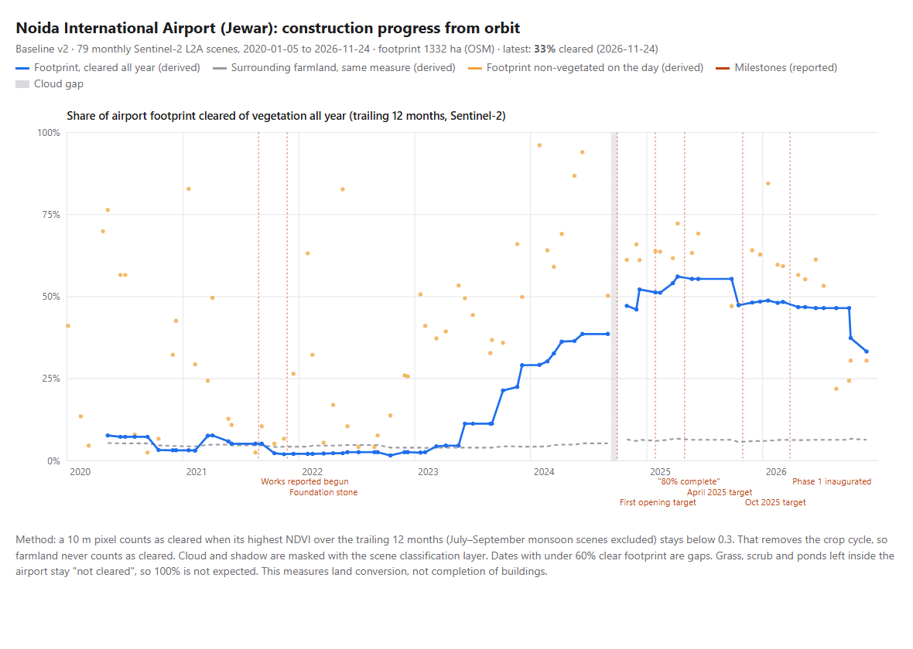

# NavContinuity

**Airline disruption intelligence and passenger recovery.**

NavContinuity is a proposed airline software product. It connects early disruption evidence to network decisions and a confirmed recovery plan for each affected passenger. Its initial focus is navigation disruption: satellite-derived observations can help assess GNSS degradation, while airline systems establish what happened to flights, bookings, and bags.

> **Status:** Product and research specification. This repository does not yet contain a working application, airline integration, trained model, or measured savings.

## Why build it?

Passengers report repeated short delay extensions, missed connections, poor rebooking options, long support queues, misplaced care vouchers, and unclear baggage status. Airlines must resolve these while managing aircraft, crew, gates, seats, and downstream disruption. The central measure is **time to a confirmed, workable resolution for each affected passenger**.

## The product

`evidence → forecast → network impact → recovery options → approved action → verified passenger outcome`

- **Operations console:** evidence and uncertainty, flights and connections at risk, feasible actions, cost ranges, and passenger impact.
- **Passenger recovery flow:** truthful status and next update time, bookable alternatives, confirmed rebooking, appropriate care, baggage events, and human support.
- **Shared case record:** aligned facts and action state across operations, airport agents, contact centres, and passenger channels.

The first pilot targets navigation disruption. Other delay causes can enter the same recovery workflow once their evidence and rules are validated separately.

## What is already in market?

Airline disruption management and self-rebooking products exist, including [Amadeus Self Re-accommodation](https://amadeus.com/en/airlines/products/self-re-accommodation) and [Passenger Recovery](https://amadeus.com/en/airlines/products/passenger-recovery). The product hypothesis is that *earlier, satellite-informed disruption assessment*, a shared flight-to-passenger impact graph, and verification that recovery completed will add value to existing workflows. This needs customer testing.

## Hackathon submission (Mach-A-Thon Aeromania '26)

**Our project is aviation navigation failure and passenger (customer) experience.** Every track is fitted to it; the full mapping, the flow between tracks, and the rule risk are in **[TRACKS.md](TRACKS.md)**.

| Part | Track | Status |
|---|---|---|
| Airport and runway readiness from orbit (Jewar, Sentinel-2): the recovery capacity input | **A6 Infrastructure** (compulsory) | **Working on real data**: [a6/](a6/README.md), [data/](data/README.md) |
| Multi-constellation integrity + AI correction of positioning errors | **B3 Positioning & sensing** | Specified, not built |
| GNSS jamming/spoofing evidence and regional navigation-risk map, protective only | **C: GNSS resilience** | Specified, not built |
| Passenger recovery: status, rebooking, care, bags | Customer experience / who pays | Specified, not built |

Rules allow only **one** of B or C to be presented unless organisers confirm otherwise ([RULES.md](RULES.md) R2/R3), so the default pitch is A6 + C.

Headline (derived, Sentinel-2): land conversion inside the 1333 ha footprint starts in **mid-2023** and peaks at about **56% in April 2025**, around the reported "80% complete" claim. This metric measures land clearing, not building completion. Full method and limits are in [a6/README.md](a6/README.md).

Run it: `cd a6 && npm install && node progress.mjs && node chart.mjs` (Node.js only, about 15 minutes on the first run).

## Read the documents

- [Product specification](PRODUCT_SPEC.md): users, workflow, data, build sequence, acceptance criteria, and economics.
- [Research and evidence](RESEARCH.md): passenger complaints, existing products, rights references, and validation questions.
- [Team brief v1.1](NavContinuity_Team_Brief.md) ([PDF](NavContinuity_Team_Brief.pdf)): hackathon specification, restructured as A6 primary plus Track C optional after the organisers' 9:36 pm update. Its track requirements govern the hackathon build, not the long-term product scope.
- [Event rules](RULES.md) ([PDF](RULES.pdf)): deck plus organiser messages, consolidated.
- [Plan of action](PLAN.md): what is left before judging, in priority order.

## Proposed first build

Replay one historical navigation disruption with traceable observations and flight data. Show flights, connections, and simulated passenger journeys at risk; compare feasible recovery actions; then show the passenger timeline and whether booking, care, and baggage actions were confirmed or failed. Benchmark against a transparent baseline. Label synthetic records and assumed costs.

A live pilot requires airline-approved access to operations, reservations, seat inventory, ticketing, baggage, care suppliers, and policies. Without those integrations, a prototype cannot complete a real rebooking or issue a usable voucher.

## Product rules

- Distinguish **observed**, **predicted**, **proposed**, **requested**, **confirmed**, and **failed** states.
- Never say a passenger is rebooked until the authoritative airline system confirms it.
- Show the last confirmed bag scan; do not present an inferred location as fact.
- Apply airline-approved safety, operational, privacy, and passenger-care rules with human override.
- Measure total recovery cost and passenger outcomes, including false alarms and costs shifted to other travellers.
